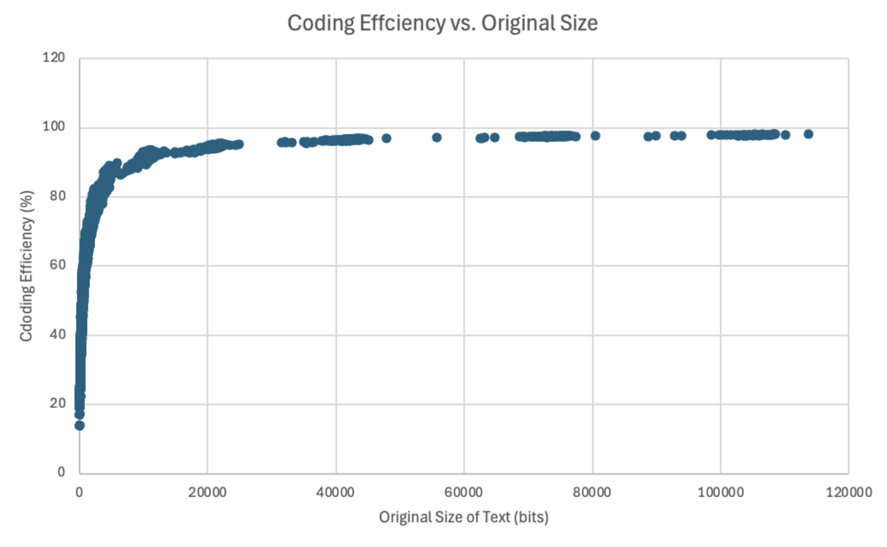

# Huffman Coding

  
A Huffman coding compressor and decompressor written in C, built to measure how close the algorithm gets to the entropy limit on natural language.

On *Moby Dick* (643.2 KB) it produces a 365.2 KB file, a 1.76× reduction, with an average codeword length within 1% of the text's symbol entropy.

## Quick Start

Requires CMake 3.20+ and a C17 compiler. Run every command from the project root.

Building:
```bash
cmake -S . -B build
cmake --build build
```
Compressing:
```bash
./build/compress
```
Decoding:
```bash
./build/decode
```
Compare decoded file and inputted file:
```bash
cmp data/mobydick.txt output/mobydick.txt && echo "Recovered OK"
```

With no arguments, `compress` reads `data/mobydick.txt` and writes `output/mobydick.bin`, and `decode` turns it back into `output/mobydick.txt`.

## Usage

The build produces three executables in `build/`; outputs go to `output/`.

| Command | Does | Default Input | Default Output |
| ------- | ---- | ------------- | -------------- |
| `compress [input] [output]` | Compresses a file | `data/mobydick.txt` | `output/[name].bin` |
| `decode [input] [output]` | Restores a compressed file | `output/mobydick.bin` | `output/[name].txt` |
| `write_results [input] [chunk size]` | Writes compression statistics to a CSV without compressing | `data/mobydick.txt` | `output/[name].csv` or `output/[name]-[chunk size].csv` |

`[name]` is the input's file name without its directories or extension, so `data/mobydick.txt` becomes `mobydick`. An explicit output path is used exactly as given.

## How It Works
### Compressing
1. **Count** how often each symbol occurs, and the total number of symbols.
2. **Create the leaves:** one node per distinct symbol, holding its symbol and frequency, stored in a node array size for the whole tree (`2 × distinct − 1` nodes)
3. **Build a min-heap** in a second array that holds node indices rather than nodes, ordered by each node's frequency, using Floyd's algorithm for linear-time construction
4. **Build the tree** by repeatedly popping the two least frequent indices, adding a new parent node to the end of the node array with those two as its children, and pushing the parent's index back onto the heap, until one index remains: the root
5. **Build a lookup table** of each byte's codeword by walking the tree from the root: left adds a '0', right adds a '1'
6. **Write the header**: the symbol count, then the tree (see [File Format](#file-format))
7. **Rewind the input** and write each byte's codeword from the lookup table
8. **Pad** the last byte with '0's

Frequent bytes end up near the root and get short codewords; rare bytes get long ones. Nodes never move once they are placed in the node array, and children are referenced by array index rather than pointer. Only the heap of indices is reordered, so each swap moves a 4-byte index instead of a 24-byte node. Symbols are assumed to be a single byte.

### Decoding
1. **Read the symbol count** from the first 64 bits
2. **Rebuild the tree** from its pre-order encoding into a node array
3. **Decode each symbol**: start at the root, go left on '0' and right on '1' until a leaf is reached, and write its byte to the output file
4. **Stop** once the symbol count is reached, so the padding bits are never decoded as symbols

Decoded bytes are written straight to the output file, so memory use does not grow with file size. If the input ends before the expected number of symbols is decoded, `decode` stops with an error.
### Edge Cases
* **One distinct byte** (e.g. `aaaa`): a Huffman tree needs two leaves, so an unused second leaf is added and the real byte gets a 1-bit codeword
* **Empty input**: only the symbol count of 0 is written, with no tree, and decodes to an empty file

### Writing Results

As I wanted to explore how input size impacts coding efficiency, `write_results` takes chunk size (bytes) as an argument, splitting the input into chunks of that many bytes and building a separate Huffman tree for each. Each chunk becomes a row in the CSV; a final partial chunk is left out. By default, chunk size is 0, which builds a Huffman tree for the whole file.

The CSV has these columns, all in bits:

| Column | Meaning |
| ------ | ------- |
| Original Size | Input size |
| Compressed Size | Header + encoded data + padding; equals the real `.bin` size |
| Header Size | 64-bit symbol count + encoded tree |
| Entropy | Shannon entropy per symbol |
| Average Symbol Codeword Length | Average code length, weighted by frequency |
| Average Symbol Codeword Length with Header | Compressed size ÷ number of symbols |
### File Format

All fields are packed bit by bit, most significant bit first, with no alignment between them.

```
┌───────────────────┬────────────────────────┬───────────────────────┬─────────┐
│    Symbol count   │    Tree (pre-order)    │      Encoded data     │ Padding │
│       64 bits     │ 10 × distinct − 1 bits │ Σ frequency × length  │ 0–7 bits│
└───────────────────┴────────────────────────┴───────────────────────┴─────────┘
```

The tree is written in pre-order: each internal node is a '0' bit followed by its left then right subtree, and each leaf is a '1' bit followed by its 8-bit symbol. A tree with `d` leaves has `d − 1` internal nodes, so it takes `9d + (d − 1) = 10d − 1` bits. *Moby Dick* has 88 distinct bytes, giving a 879-bit tree and a 943-bit (117.9-byte) header.

## Results

### Compressing Moby Dick

The compression algorithm is tested on the novel [Moby Dick (.txt file)](https://gist.github.com/StevenClontz/4445774):

| Original Size | Compressed Size | Header Size | Symbol Entropy (bits) | Average Codeword Length (bits) | Coding Efficiency | Compression Ratio |
| ------------- | --------------- | ----------- | --------------------- | ------------------------------ | ----------------- | ----------------- |
| 643.2 KB      | 365.2 KB        | 117.9 Bytes | 4.50                  | 4.54                           | 99%               | 1.76              |

* **Coding efficiency** = entropy ÷ average codeword length. 100% would mean the codewords are as short as the text's statistics allow
* **Compression ratio** = original size ÷ compressed size

Each byte drops from 8 bits to 4.54 bits on average. Huffman coding cannot beat the 4.50-bit entropy because every codeword must be a whole number of bits.

### Coding Efficiency vs. Input Size



Efficiency is low for small inputs and climbs above 90% once the input passes roughly 10,000 bits (1.25 KB). Header cost scales with the alphabet and not input size, so its share of the output size falls as input grows. Moreover, the alphabet quickly saturates. Distinct symbols are capped at 256 and English prose uses only ~95 symbols, and because the distribution is heavily skewed towards the common symbols, they all appear within the first few hundred bytes. The remaining rare symbols trickle in over many more KB. So the header size reaches close to its maximum on small input sizes, and both its growth rate and relative cost fall as the input grows.